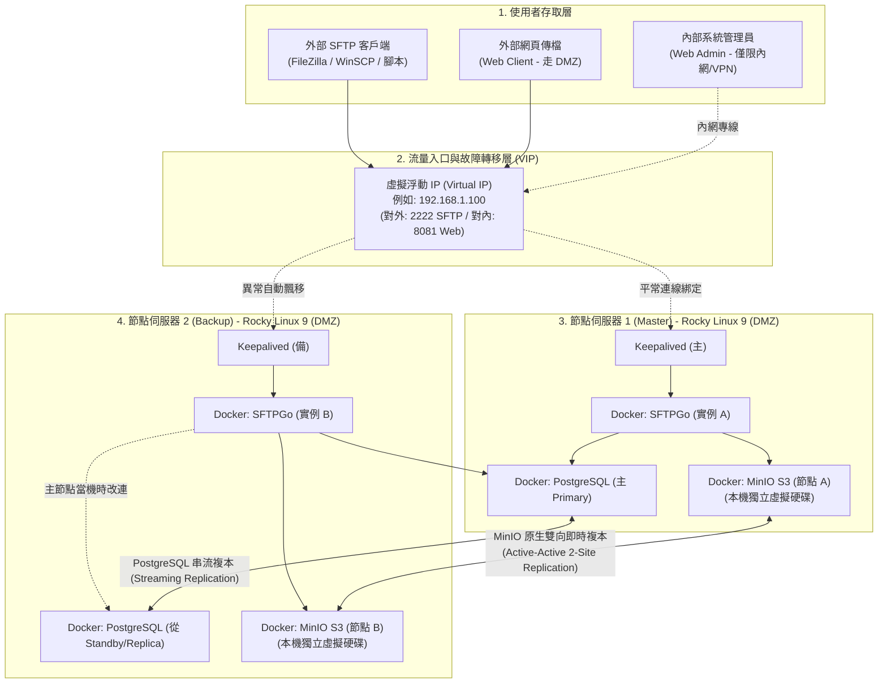

# 企業級高可用 SFTP 檔案交換平台架構規劃書
## 基於 SFTPGo + MinIO + PostgreSQL + Rocky Linux + Docker 的現代化雲原生方案

---

## 一、 執行摘要（Executive Summary）

隨著企業內部傳輸業務與對外（B2B / Client-Facing）資料交換需求日益頻繁，現行許多企業仍倚賴傳統的「單台 Windows Server 搭配商用 FTP 軟體（如 Serv-U）」進行維運。此架構目前面臨三大嚴峻挑戰：
1. **單點故障風險（SPOF）**：單台主機維護、重啟或硬體當機時，全公司傳檔服務即刻中斷。
2. **授權與維護成本高昂**：Windows Server OS、CAL 授權與 Serv-U 商業授權費用高昂，且過保後無法取得漏洞修補。
3. **抗勒索病毒與資安防護薄弱**：NTFS 本地磁區缺乏物件防護，容易遭勒索病毒集體加密；傳統 C/C++ 架構在歷史上面臨多次重大遠端代碼執行（RCE）零日攻擊。

本規劃書提出基於「Rocky Linux + Docker 容器化」的新世代架構，採用 SFTPGo 現代傳輸閘道，並整合 MinIO S3 物件儲存與 PostgreSQL 關聯資料庫，在「兩台虛擬機（2-Node Hyper-converged）」的精簡架構下，實現了前端秒級故障自動轉移與後端毫秒級雙向鏡像的高可用備援機制，且軟體授權成本為 0 元。

---

## 二、 核心選型深入評估：為什麼是 SFTPGo？

在開源領域中有許多檔案傳輸工具（如純 OpenSSH、ProFTPD、vsftpd 等），本架構選用 **SFTPGo** 作為核心閘道，主要基於其在**技術架構、穩定度與成熟度**上的絕對優勢：

### 2.1 開發架構與穩定度表現
1. **Go 語言原生高效能與記憶體安全**：
   - SFTPGo 採用 **Go (Golang)** 開發，編譯為靜態二進位檔（Static Binary），具有極低的記憶體佔用（平常待機僅需數十 MB RAM）。
   - 相比於傳統 C/C++ 撰寫的舊型 FTP 軟體，Go 語言天然具備**記憶體安全（Memory Safety）**特性，徹底杜絕了 Buffer Overflow（緩衝區溢位）等底層致命安全漏洞。
2. **高並發連線處理（Goroutine 輕量行程）**：
   - 傳統 FTP 伺服器每個連線往往需要佔用一個 OS Thread，並發量大時伺服器負載劇增。SFTPGo 善用 Go 輕量 Goroutine 機制，單一節點可輕鬆應付**數千條以上並發 SFTP/HTTP 傳輸連線**，系統負載與 CPU 波動依然維持極低水準。
3. **內建主動防禦機制（Defender）**：
   - 內建暴力破解防護（Brute-force protection），能自動分析頻繁失敗的登入請求，在應用層動態封鎖可疑來源 IP，不需額外依賴外部安全模組。

### 2.2 成熟度與開源社群指標
* **產業普及度**：GitHub 獲得 **超過 8,500+ 顆星**，官方 Docker 映像檔（`drakkan/sftpgo`）下載量達到**數千萬次**。
* **維護持續性**：專案自 2019 年釋出至今已有 6~7 年的成熟期，版本演進嚴格遵守語意化版本（Semantic Versioning），歷史釋出超過 100+ 個正式版本。
* **跨國企業驗證**：廣泛被全球大型科技公司、金融保險與政府機關應用在生產環境中，並提供標準的 Kubernetes Helm Charts、Docker Compose 與 Linux Systemd 封裝，技術生態成熟完善。
* **漏洞修補速度**：社群高度活躍，每逢相關安全通報（CVE），核心團隊平均在 **24~48 小時內**即完成修補並發布新映像檔，安全維護敏捷度遠勝封閉原始碼的商業套裝軟體。

---

## 三、 企業對外服務（Client-Facing）資安防禦與弱點維護評估

企業將傳輸系統置於網際網路提供外部客戶與協力廠商使用時，核心痛點在於：**「開源專案會不會遇到重大弱點沒人修？是否適合直接對外？」** 經深度技術評鑑，答案是：**非常適合，且安全性與修補時效遠優於傳統閉源軟體**。

### 3.1 弱點更新時效深度對比：SFTPGo 開源模式 vs. Serv-U 商業閉源

| 評比面向 | 傳統商業閉源軟體（如 Serv-U、MOVEit） | 現代開源雲原生方案（SFTPGo） |
| :--- | :--- | :--- |
| **漏洞暴露與修補機制** | ❌ **閉門造車，滯後響應**<br>歷史上 Serv-U (如 CVE-2021-35211 RCE 零日漏洞) 與 MOVEit 均曾爆發全球重大外洩事件。廠商通常在遭受 0-day 攻擊後才著手研發補丁，修補週期動輒數週到數月。 | ✅ **全球審計，敏捷修補**<br>代碼全球公開，成千上萬資安研究員與靜態分析工具（CodeQL/Snyk）每日審計。一旦確認 CVE，核心團隊平均於 **24~48 小時內**即釋出新版本與 Docker 映像檔。 |
| **過保與升級阻力** | ❌ **過保即孤兒，升級高風險**<br>若企業未每年繳納高額維護合約，原廠直接拒絕提供安全補丁；升級軟體需執行安裝精靈、修改登錄檔並重新開機，常導致服務中斷。 | ✅ **終身免費更新，30 秒無感升級**<br>無軟體維修合約門檻。Docker 環境下僅需執行 `docker compose pull && docker compose up -d`，**30 秒內即可完成熱更新**，消滅資安空窗期。 |
| **底層安全免疫力** | ❌ **C/C++ 歷史架構漏洞隱患**<br>底層仍有緩衝區溢位、指標記憶體洩漏風險，容易成為駭客奪取主機最高 root/SYSTEM 權限的跳板。 | ✅ **Go 語言原生記憶體安全**<br>編譯層天生免疫緩衝區溢位，大幅收斂潛在攻擊面。 |

### 3.2 專為對外服務設計的五大原生安全防線
1. **完全無作業系統 Shell 權限（Chroot & No Shell by Design）**：
   - 外部客戶連線時，SFTPGo 採用專屬虛擬檔案引擎，**絕不開放任何底層 Linux Shell**。客戶被嚴格囚禁在自己的虛擬目錄中，就算輸入惡意指令也無法跳出容器。
2. **內建 Defender 主動防禦模組**：
   - 面對外網常見的自動化暴力密碼猜測，內建 Defender 會在客戶連續密碼錯誤達閥值時，**自動動態將該來源 IP 暫時或永久封鎖**。
3. **帳號專屬 IP 白名單限制（IP Filtering）**：
   - 可針對特定外包商或重要客戶帳號，在管理後台直接指定「僅限該客戶公司的固定公網 IP 連入」，即使帳密外洩，攻擊者自外部 IP 依然無法登入。
4. **強制多因子驗證（2FA/MFA）與公鑰認證**：
   - **SFTP 協定**：可強制關閉密碼驗證，強制要求客戶必須提供 **SSH Public Key** 連線。
   - **Web Client 網頁傳檔**：原生支援 Google Authenticator 等 TOTP **雙因子驗證 (2FA)**。
5. **精細化防誤刪權限控制**：
   - 可將外網帳號設為「僅允許上傳與追加，禁止覆蓋與刪除」，防止客戶不慎覆蓋檔案或惡意刪除資料。

### 3.3 企業對外標準資安防禦縱深架構（DMZ 區與管理後台內縮）

為確保對外環境具備金融級安全防護，全系統規劃嚴格的「**管理後台內縮原則**」與「**DMZ 隔離**」：

```
網際網路客戶 (Internet Clients)
       │
   [ 企業邊界防火牆 (External Firewall) ]
       │ 僅開放對外服務埠：TCP 2222 (SFTP)
       ▼
┌────────────────────────────────────────────────────────┐
│                   企業 DMZ 隔離區                       │
│  [ Keepalived 漂移 VIP : 192.168.1.100 ]               │
│   ├── Rocky Linux 節點 1 (Docker SFTPGo + MinIO + PG)  │
│   └── Rocky Linux 節點 2 (Docker SFTPGo + MinIO + PG)  │
└────────────────────────────────────────────────────────┘
       │
   [ 企業內部防火牆 (Internal Firewall) ]
       │ 🚨 嚴禁外網直接穿透！
       ▼
   企業內部 IT 管理人員 (Intranet / VPN)
   👉 僅限內網存取：Web Admin 管理後台 (Port 8081)
```

> **📌 資安鐵則**：
> 外部客戶**只能接觸到 Port 2222 的純 SFTP 服務**。系統管理後台（Port 8081）絕不對網際網路開放，駭客在外部連後台登入頁面都碰不到，徹底杜絕管理介面被暴力破解的可能。

### 3.4 企業稽核合規備案：官方商業支援服務（Enterprise Support）
若企業所處產業（如金融、醫療、上市上櫃公司）之法規稽核硬性規定「對外核心系統必須簽訂商業服務維護合約（SLA）以釐清責任」：
- **方案備案**：SFTPGo 官方團隊（Nicola Murino 核心團隊）提供正式的 **商業支援訂閱（Commercial Support Plans）**。
- 企業可直接向官方簽訂企業支援合約，取得專屬故障排除 SLA 與諮詢服務，徹底化解合規責任歸屬的疑慮。

---

## 四、 企業級全端高可用備援架構設計

全系統由「**流量接入層**」、「**應用運算層**」、「**共用資料庫層**」與「**底層儲存層**」四層所構成，確保任一節點、任一服務元件故障時皆有即時備援接管。

### 4.1 架構拓撲圖（超融合雙節點架構）



---

## 五、 共用資料庫（Shared Database）規劃深度分析

SFTPGo 預設使用的 SQLite 是本機單一檔案，在雙機備援架構下**無法自動跨機器同步**。因此，必須引入外部關聯式資料庫來統一存放「帳號、密碼雜湊、公鑰、虛擬目錄、配額與 Audit Log」。

### 5.1 建議選用哪種資料庫？為什麼首選 PostgreSQL？

我們**強烈推薦使用：PostgreSQL**（而非 MySQL / MariaDB），原因如下：

| 評估維度 | PostgreSQL（強烈推薦首選） | MySQL / MariaDB |
| :--- | :--- | :--- |
| **SFTPGo 原生契合度** | **官方 CI/CD 測試的第一優先資料庫**，所有進階功能皆優先保證與 PostgreSQL 完美相容。 | 雖有支援，但多數新特性的自動化回歸測試以 PostgreSQL 為基準。 |
| **JSONB 支援與效能** | SFTPGo 大量使用結構化 JSON 儲存使用者權限屬性與延伸設定。PostgreSQL 對 **JSONB 二進位儲存與索引檢索**是業界公認效能最強且最嚴謹的引擎。 | MySQL 的 JSON 支援為後期加入，在靈活度與複雜條件過濾上略遜於 PostgreSQL。 |
| **資料庫授權風險** | **正統開源（PostgreSQL License）**，完全自由，企業可無限制商業使用，無任何版權訴訟陰影。 | 目前由 Oracle 公司主導控制，有商業版與 GPL 版的區別，部分企業資安與法務會有所顧慮。 |
| **高可用複製技術** | 內建成熟穩定的 **WAL 實體串流複製（Physical Streaming Replication）**，延遲極小、資料不失真。 | 依賴 Binlog 邏輯複製或複雜的 Galera Cluster，配置與維護門檻較高。 |

---

### 5.2 共用資料庫該如何部署？（獨立 2 台 VM vs. 現有 2 台節點中容器化）

這是系統規劃時最關鍵的架構抉擇：

#### 方案比較：

| 評估面向 | 方案 1：放在既有 2 台節點內（Docker 容器化）<br>⭐ **【最推薦做法】** | 方案 2：另外開 2 台獨立 VM 來跑 DB |
| :--- | :--- | :--- |
| **硬體與授權成本** | **零額外成本！** 直接沿用這 2 台 Rocky Linux，不需多開 VM。 | 需要額外向虛擬化平台申請 2 台專屬 VM，佔用額外的 CPU、RAM 與 IP 資源。 |
| **架構負載評估** | **負載極低，完全不會搶資源**。<br>SFTP 傳輸時，99.9% 的流量與 I/O 都落在 MinIO 上；PostgreSQL **只在使用者登入驗證、或管理員變更帳號時**產生幾毫秒的微量查詢。 | 專機專用，資源完全隔離；但對 SFTP 系統而言有「**過度設計（Overkill）**」之嫌。 |
| **維護複雜度** | **簡單集中**。全部透過一份 `docker-compose.yml` 統籌管理（包含 SFTPGo、MinIO、PostgreSQL）。 | IT 人員需要多照顧 2 台 VM 的 OS 更新、安全性修補與備份。 |

#### 最佳落地部署建議：
1. **若公司內部本來就有現成的企業級共用資料庫叢集**（例如公司已有正式的 PostgreSQL 或 MySQL HA）：
   👉 **直接連現成 DB**。在 SFTPGo 填入既有 DB 的 IP 與帳密即可，連容器都不用開。
2. **若無現成 DB，需自行搭建**：
   👉 **採用「方案 1：超融合容器化部署」**！
   - 在節點 1 的 Docker 啟動 `postgres:15-alpine`（作為 Primary 主庫）。
   - 在節點 2 的 Docker 啟動 `postgres:15-alpine`（作為 Standby 複本庫）。
   - 兩者之間啟用 PostgreSQL 原生的**非同步串流複製**，節點 1 產生的任何帳密變動會在數毫秒內同步至節點 2。
   - 節點 1 異常時，節點 2 可無痛提升為主庫接管，達成零中斷。

---

## 六、 新舊世代架構全方位對比（Serv-U on Windows vs. 新型雲原生架構）

過去企業普遍採用「Windows Server + Serv-U FTP Server」商用軟體，以下透過多維度評估，客觀展示現代化架構帶來的效益：

### 6.1 綜合指標比較表

| 比較項目 | 傳統方案：Windows Server + Serv-U | 現代方案：Rocky Linux + Docker + SFTPGo + MinIO + PostgreSQL |
| :--- | :--- | :--- |
| **1. 軟體授權費用 (TCO)** | ❌ **昂貴的商業授權支出**<br>• Windows Server 作業系統授權與 CAL。<br>• Serv-U 商業軟體購買與每年昂貴的維護合約。 | ✅ **零軟體授權費（成本為 0）**<br>全架構組件皆為世界級主流開源專案，省下數十萬預算。 |
| **2. 高可用性 (HA) 與災難復原** | ❌ **架構脆弱，多為單點運作**<br>Serv-U 做雙機叢集門檻極高且需昂貴授權，多數僅單機運作。主機當機或維護時，業務完全中斷。 | ✅ **全端秒級自動容錯**<br>前端 Keepalived VIP 自動轉移（< 2 秒），後端 MinIO 即時雙向鏡像，業務不中斷。 |
| **3. 資安防護與抗勒索病毒** | ❌ **攻擊目標熱點，防禦脆弱**<br>• Serv-U 歷史上曾多次被公開重大 RCE 零日漏洞。<br>• Windows NTFS 易遭勒索病毒全面加密，只能仰賴有限的磁區快照還原。 | ✅ **容器沙箱隔離 + 物件版本控制**<br>• Docker 容器層與宿主機核心隔離，無 Shell 執行權限。<br>• MinIO 支援 **Object Versioning**，檔案被加密仍保有歷史乾淨版本，可單檔秒級還原。 |
| **4. 弱點修補時效** | ❌ **修補漫長，過保即無更新**<br>仰賴原廠單一開發團隊，修補週期數週以上；未購年約者無法取得補丁。 | ✅ **極速響應，30 秒無感升級**<br>CVE 通報平均 24~48 小時釋出更新，Docker 指令 30 秒升級完成。 |
| **5. 系統更新與維運衝擊** | ❌ **被迫頻繁重新開機**<br>Windows 每月發布安全更新（Patch Tuesday）幾乎都必須重啟系統，造成傳檔中斷。 | ✅ **滾動更新，零中斷維護**<br>Rocky Linux 核心長年穩定；Docker 容器升級僅需數秒，管理者可在白天上班時間輪流對單一節點升級。 |
| **6. 存取協定與彈性** | ⚠️ **以舊型 FTP 協定為主**<br>網頁端介面老舊，缺乏原生對接 S3 雲儲存與物件儲存的能力。 | ✅ **跨世代多協定支援**<br>同時原生支援 **SFTP、FTPS、WebDAV、現代化 Web 網頁檔案總管**，並可直連各類 S3 儲存。 |

---

## 七、 給系統管理者的思維轉變指南（Mindset Shift）

對於習慣 Windows 視窗操作的管理者，走向本架構並不需要承擔巨大的學習成本，反而能獲得三大實質解脫：

1. **管理完全圖形化，無需背誦 Linux 指令**：
   - 雖然底層是 Rocky Linux，但日常維運人員**「完全不用進命令列終端機」**。
   - 新增帳號、修改密碼、設定目錄權限、限制配額、查閱連線 Audit Log，**100% 都在 SFTPGo 的繁體/簡體中文 Web 管理後台點選完成**。
2. **從「伺服器寵物維護」轉變為「自動化免洗容器」**：
   - 傳統 Windows 主機損壞時，需耗費數小時還原整台 VM。
   - 本架構將「運算（Docker）」與「儲存（MinIO）」徹底分離。主機上所有設定皆收斂在一份 `docker-compose.yml` 中，即使整台主機損毀，以腳本原地重構只需 **3 分鐘**。
3. **終結半夜被叫醒搶修的惡夢**：
   - 依靠單機運作的 Serv-U，只要硬體故障就必須立刻人工搶修。
   - 現代高可用架構下，任何一台節點伺服器故障，VIP 自動飄移接管，業務正常運行，維運團隊可在上班時間再進行硬體更換。

---

## 八、 結論與落地推動建議

本技術方案以 **SFTPGo** 為核心，結合 **PostgreSQL 帳號同步** 與 **MinIO S3 雙向即時複本**，成功在 2 台 Rocky Linux 伺服器上實現了**超融合（Hyper-converged）的高可用架構**。

在資安層面，透過 **Go 語言記憶體安全、完全無 Shell 限制、內建 Defender 防暴力破解、DMZ 管理後台內縮** 以及 **官方商業技術合約備案**，能完全滿足企業對外（Client-Facing）提供服務的高標準法規與防禦需求。

### 建議推動時程：
1. **第一階段（環境建置與驗證，約 2 天）**：
   - 於虛擬化平台（vSphere / Proxmox / Hyper-V）建立 2 台 Rocky Linux 9 VM。
   - 部署包含 SFTPGo、MinIO 與 PostgreSQL 的 Docker Compose 環境。
2. **第二階段（高可用與資安演練，約 2 天）**：
   - 配置 Keepalived 漂移 VIP。
   - 實施外網連線防護測試（驗證 Defender 阻斷機制與管理後台內縮隔絕）。
   - 進行強制關機、拔除虛擬網卡測試，驗證 VIP 切換與 MinIO 檔案雙向補齊機制。
3. **第三階段（平順換軌切換，約 1 天）**：
   - 批次將舊 Serv-U 的帳號匯入 SFTPGo。
   - 將內部網路與外網的 SFTP 連接埠指向新架構 VIP，正式除役老舊系統。
